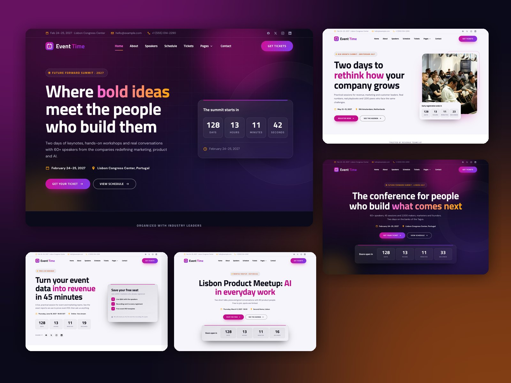
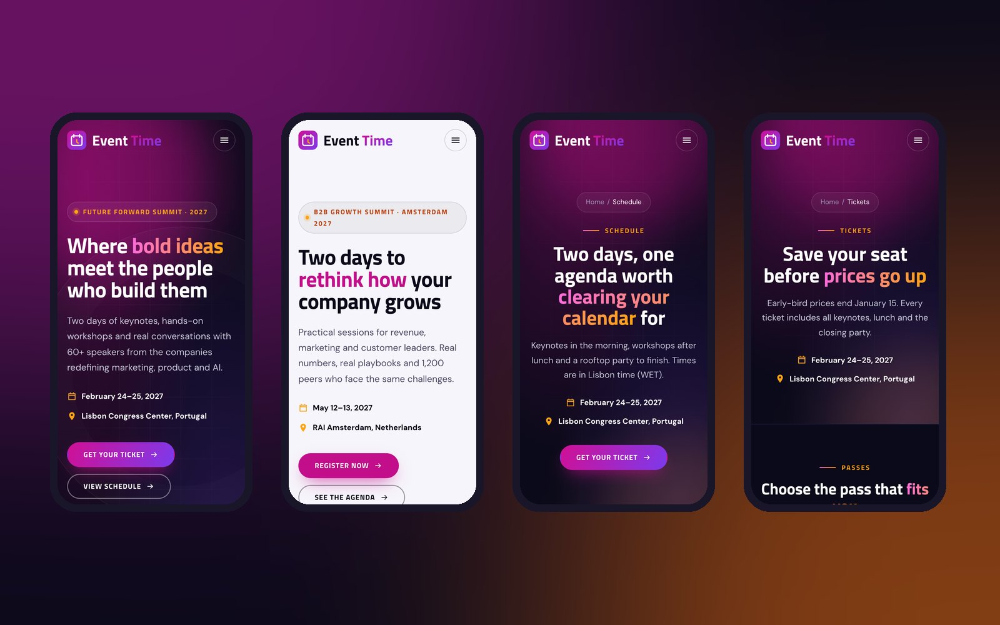

# Build your event site

## Recommended pages

A typical event site uses these templates. Create the pages you need and skip the rest.

| Page | Template to choose |
|---|---|
| Home | One of the 5 home templates (see below) |
| Speakers | **Speakers** |
| Schedule | **Schedule** |
| Tickets | **Tickets** |
| Venue | **Venue** |
| Sponsors | **Sponsors** |
| About | **About** |
| Contact | **Contact** |
| Registration thank you | **Registration thank you** |
| Coming soon / waitlist | **Coming soon** (use it before tickets go on sale) |

## Choose a home page

| Template | Best for |
|---|---|
| **Home** | Dark conference site with countdown, agenda, tickets and blog posts |
| **Home (centered hero)** | Keynote-style layout with a centered heading and countdown |
| **Home (corporate summit, light)** | Light, corporate B2B summit with a photo hero |
| **Home (webinar or virtual event, light)** | Registration page for a webinar or online event |
| **Home (meetup or workshop, light)** | Small meetups and workshops with an RSVP form |

## Create a page

1. Go to **Content › Website Pages** and click **Create › Website page**.
2. Choose **Event Time** and pick a template.
3. Give the page a name, then replace the demo text and images. Every section is a module: click it to edit it in the left sidebar.
4. Set the page URL, title and meta description in **Settings**.
5. Click **Publish** when you're ready.

!!! tip

    Every template comes filled with realistic demo content, so you can see how each section is meant to look. Edit the text rather than starting from an empty page.

## Add, move and remove sections

* **Add** a module or section: click **+** (Add) in the left sidebar, find it by name (for example "Schedule Tabs") and drag it onto the page.
* **Move** a section: drag it by its handle in the page editor.
* **Remove** a section: hover over it and click the delete icon.

## Link your pages together

1. Create a navigation menu in **Settings › Content › Navigation menus** with your new pages.
2. Choose that menu in the site header (see [Header and footer](header-and-footer.md)).
3. Update the button links in each page (for example "Get your ticket" should point to your Tickets page).

## Before you publish

- [ ] Set the event date in every countdown (hero, countdown and coming soon modules)
- [ ] Choose your HubSpot forms (see [Forms and the registration flow](forms-and-registration.md))
- [ ] Replace the demo speaker photos, logos and gallery images
- [ ] Check the header menu and footer links
- [ ] Preview on mobile with the device switcher in the page editor

