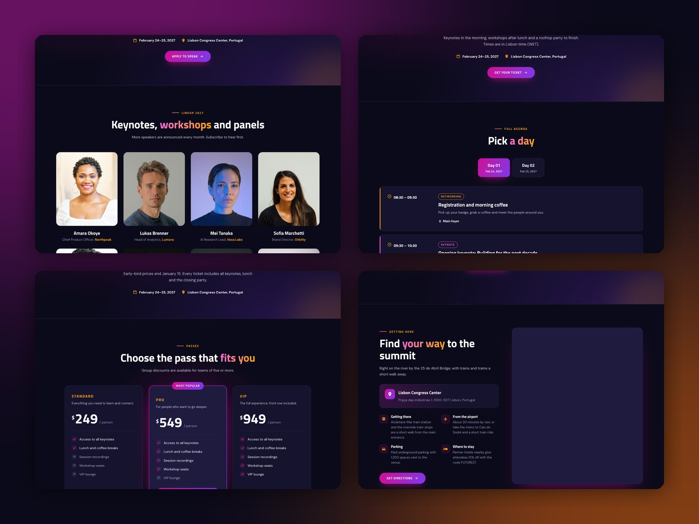

# Page templates

Event Time has 14 page templates. Each one is a drag-and-drop page filled with demo content, so you can edit, move, add or remove any section.

## Home pages

| Template | Scheme | Sections |
|---|---|---|
| **Home** | Dark | Hero with countdown card, logo strip, about with video, marquee, schedule, countdown, speakers, call to action, ticket pricing, testimonials, FAQ, newsletter, recent blog posts |
| **Home (centered hero)** | Dark | Centered hero, logo strip, speakers, marquee, about with video, schedule, gallery, sponsors, ticket pricing, venue map, FAQ, call to action |
| **Home (corporate summit, light)** | Light | Hero with side photo, logo strip, about with video, speakers, schedule, ticket pricing, testimonials, FAQ, call to action |
| **Home (webinar or virtual event, light)** | Light | Registration hero with countdown and form, info cards, speakers, agenda, FAQ, call to action |
| **Home (meetup or workshop, light)** | Light | Hero, info cards, agenda, speakers, RSVP form, venue map, newsletter |

## Event pages

| Template | Sections |
|---|---|
| **Speakers** | Page intro, speakers, call to action, newsletter |
| **Schedule** | Page intro, schedule tabs, countdown, speakers, newsletter |
| **Tickets** | Page intro, ticket pricing, marquee, FAQ, call to action |
| **Venue** | Page intro, venue map, travel info cards, gallery, hotel cards, FAQ, call to action |
| **Sponsors** | Page intro, sponsor tiers, benefit cards, sponsorship packages, contact form |
| **About** | Page intro, about with video, marquee, gallery, logo strip, testimonials, call to action |
| **Contact** | Page intro, contact form, venue map, FAQ |
| **Coming soon** | Full-screen teaser with countdown and waitlist form, logo strip |
| **Registration thank you** | Confirmation with ticket card and add-to-calendar buttons, next-step cards, FAQ |

!!! note

    The **Coming soon** page has a logo-only header and a slim footer, so visitors focus on the waitlist form. Its logo is set on the page itself, not in the global header. Keep the **Coming soon** and **Registration thank you** pages out of your navigation menu.
